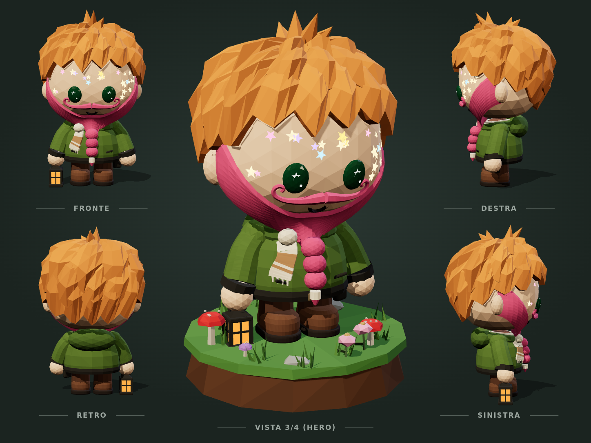
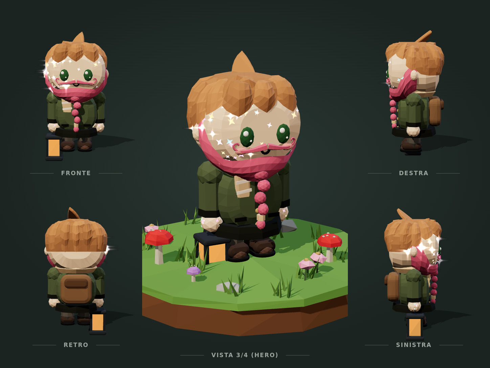

# Audit di fattibilità: personaggi nello stile "v2" (concept del Custode)

Il concept del Custode ha:
- una testa tonda e grande;
- capelli voluminosi a ciocche che escono dalla sagoma;
- una barba a maschera con la treccia e baffi a manubrio grandi;
- brillantini a stella e occhi grandi e lucidi con il riflesso a stella;
- una giacca con cappuccio e cintura, e stivali tondi.

Ho costruito un **prototipo separato**, fuori dal gioco, per valutarne la fattibilità; al posto della borsa del concept tiene la lanterna.

- Pagina: `proto-custode.html`, solo con `npm run dev`. Non è nella build né collegata al gioco.
- Codice: `src/proto/custodeV2.ts` (modello) e `src/proto/turnaround.ts` (tavola).
- Confronto: `proto-custode.html?v=attuale` mostra il Custode di oggi, con un aspetto simile al concept, nella stessa tavola e con la stessa luce.

## Seconda versione del prototipo

La prima versione era troppo lontana dal concept. Ho rifatto il modello misurando la vista frontale del concept:
- **Proporzioni:** testa e capelli occupano ~60% dell'altezza, il corpo è basso e paffuto con gambe cortissime, e la testa poggia sopra il colletto.
- **Volto:** occhi, baffi e bocca stanno nella metà bassa della testa, con una fronte grande.
- **Capelli:** massa tonda a scaglie di ciocche corte a punta, al posto delle ciocche lunghe e pendenti.
- **Barba:** fascia lungo la mandibola, non più una maschera sul viso.
- **Dettagli:** baffi più larghi, brillantini più grandi e radi, orecchie grandi e tonde, manone, stivaloni con suola spessa.
- **Zolla:** più piccola e più scura.

Terza passata:
- **Testa:** non più sferica ma "superellissoide", più piena di una sfera, con la faccia più piatta davanti e appena più larga sulle guance.
- **Capelli:** la calotta è il volume vero e le ciocche ci si appoggiano sopra, quindi non sembrano più staccate dalla testa; tra una ciocca e l'altra si legge il solco.
- **Barba:** ha un bordo inferiore pieno e più scuro, con il collo in ombra, così si stacca dalla giacca.
- **Corpo:**
  - giacca morbida "a pera" con sezione ovale, cappuccio ripiegato e bordo morbido attorno al collo;
  - cintura con fibbia, borsello sul fianco e tasche oblique;
  - maniche morbide che scendono in fuori e si allargano al polso, polsini scuri e manone;
  - gambe larghe e stivaloni.

Quarta passata:
- **Testa:** più bassa, quindi meno fronte; il mento resta dov'era, scende la sommità. Anche la frangia è più bassa.
- **Ciocche:** più spesse, più varie in larghezza, lunghezza e direzione, con le punte un po' sollevate.
- **Sciarpa:** ha un nodo che esce da sotto la barba, prima del capo che scende sul petto.
- **Bocca:** un po' più grande, tra baffi e barba.

Quinta passata:
- **Testa:** un po' più in alto, così barba e colletto non si sovrappongono; tra i due resta il giro della sciarpa.
- **Barba:** meno gonfia, sale lungo la guancia prima dell'orecchio.
- **Treccia:** attaccata davanti al mento (prima finiva dentro il colletto), con lobi intrecciati alternati, fermaglio e ciuffetto finale.
- **Baffi:** ridotti del 20%.
- **Capelli:** tutte le ciocche hanno la stessa lunghezza della frangia, e dietro e ai lati ci sono più file invece di ciocche lunghe; ai lati coprono fin sopra l'orecchio.
- **Sciarpa:** un nastro morbido che segue la curva della giacca, con righe, ondeggiamento e frangia in fondo (prima era un rettangolo appoggiato).
- **Suole:** seguono la pianta dello stivale, con punta tonda e tacco.

Sesta passata:
- **Capelli:** tornati alle quattro file di prima, con le proporzioni giuste. Le ciocche hanno una lunghezza massima, così dietro non pendono più, e ai lati scendono un po' di più.
- **Barba:** non più un velo spalmato. È un volume a mezzaluna con il bordo superiore netto, che sale dalla bocca fino davanti all'orecchio, più una massa sotto il mento che sporge in avanti.
- **Treccia:** tre grani uguali impilati dritti davanti alla giacca, fermaglio color panna e punta, come nel concept.
- **Stivali:** tomaia e suola hanno la stessa pianta e la tomaia nasce dentro la suola, così il bordo è continuo e la suola non sembra staccata.
- **Sciarpa:** spostata di lato, per lasciare libera la treccia.

Settima passata (cambio di metodo: meno forme sovrapposte):
- **Testa:** più grande del 30% (con faccia, barba, baffi e capelli), scalata attorno al mento, così resta appoggiata sul colletto.
- **Barba:** un unico guscio continuo che nasce dalla pelle, con il bordo superiore netto. Avvolge guance e mandibola e sotto il mento si ispessisce in avanti e in basso, chiuso da una parete verso il collo. Niente più ellissoidi appiccicati.
- **Capelli:** poche ciocche grandi e scompigliate, come nel concept: una frangia di cinque, due giri attorno (lati e nuca) con ciocche corte che piegano ognuna per conto suo, e sette ciocche in cima che si aprono dal vortice. La copertura arriva allo stesso punto di prima.
- **Treccia:** pende davanti alla giacca, subito sotto la barba.

Ottava passata:
- **Capelli:** ogni ciocca è incollata alla testa. La faccia interna sta sulla pelle, quella esterna si gonfia e poi si assottiglia, e alla radice lo spessore è zero, così la ciocca esce dalla testa senza scalini. Le punte sono appoggiate, non sollevate.
- **Barba:** più sottile ai lati e piena solo al mento.
- **Treccia:** il primo grano parte dentro la massa del mento, quindi è attaccata in alto.
- **Occhi:** più piccoli del 10%.

Nona passata (capelli e barba ripensati guardando bene il concept):
- **Capelli:** un "casco" pieno, più largo del cranio, fatto di tre strati sovrapposti. Ogni strato è un guscio chiuso con il bordo seghettato (una punta per ciocca) e un rilievo per ciocca che scende dal vortice girando un poco. Le ciocche fanno parte del volume, quindi non possono staccarsi. Il bordo forma la frangia sulla fronte, scende sopra le orecchie ai lati e alla nuca dietro; in cima ci sono alcuni ciuffi a punta. È anche più leggero (meno triangoli).
- **Barba:** la fascia sale lungo la guancia fino ai capelli alla tempia, ha spessore medio ai lati e si chiude in un cuneo pieno sotto il mento.
- **Treccia:** costruita nello stesso spazio della barba; il primo grano parte dalla punta del cuneo e gli altri scendono toccandosi.
- **Occhi:** ancora più piccoli.

Decima passata:
- **Barba:** più sottile ai lati.
- **Treccia:** il primo grano parte metà dentro la punta della barba, gli altri scendono dritti.
- **Capelli:** meno segmenti per ciocca (4 di larghezza e 6 di altezza al posto di 6 e 9), con lo stesso aspetto. Il modello intero scende a ~12.700 triangoli, meno del Custode attuale con un look ricco.

Undicesima passata:
- **Barba:** ai lati è una striscia sottile; il volume pieno c'è solo al centro, sotto il mento, in un cuneo più grande che spinge in avanti.
- **Prima la punta finiva dietro il colletto.** Il cuneo scendeva sotto la testa e la sua punta restava dietro il bordo della giacca, per questo la treccia sembrava staccata. Ora il bordo inferiore è più alto e il cuneo va in avanti.
- **Treccia:** esce dalla punta del cuneo, calcolata con la stessa funzione della barba (`beardOffset`), così resta attaccata anche se la barba cambia.

Dodicesima passata:
- **Barba:** sotto il mento si allunga in modo uniforme da una mandibola all'altra, con forma a U e non a punta, verso il basso e un po' in avanti; le guance restano sottili.
- **Barba lunga:** lo stesso schema vale per una barba lunga senza treccia; basta aumentare `BEARD_DROP`.

Tredicesima passata:
- **Barba:** stessa forma a U della passata precedente, con più spessore solo davanti, sotto il mento, che cresce in avanti.
- **Treccia:** di conseguenza si attacca un po' più avanti.
- **Bocca:** centrata.

Quattordicesima passata:
- **Barba di profilo:** stretta in alto, davanti all'orecchio; davanti scende dritta lungo la guancia fino a sotto il mento; dietro il bordo cala in diagonale dall'orecchio al mento. Il bordo inferiore sale verso l'orecchio (`beardLow`) e la massa diminuisce gradualmente verso i lati, quindi le guance restano sottili.

## Prestazioni su telefono (app Capacitor)

Con Capacitor il gioco gira nel WebView del sistema (WKWebView su iOS, WebView di Chrome su Android): le prestazioni sono quelle del browser del telefono. Che il gioco funzioni offline non cambia nulla, perché il lavoro lo fanno GPU e CPU del dispositivo.

- **Triangoli:** ~23k per il Custode v2 non sono un problema nemmeno per telefoni di 5–6 anni fa, che reggono qualche centinaio di migliaia di triangoli a 30 fps. Conta il totale della scena: con 6–8 personaggi v2 si aggiungono ~150–200k triangoli. Sui telefoni vecchi conviene una versione alleggerita in qualità «Bassa»: meno file di ciocche, sfere con meno suddivisioni, niente stelline.
- **Cose che pesano di più dei triangoli:**
  - le ombre (raddoppiano il lavoro sulla geometria);
  - la risoluzione (pixel ratio 2–3 sugli schermi moderni);
  - la post-elaborazione (sfocatura ai bordi);
  - le luci puntiformi;
  - le parti trasparenti.

  Il gioco le regola già in base alla qualità.
- **CPU e memoria:** i modelli si generano dal codice (~45 ms il v2) e restano in cache. Su un telefono lento può diventare ~150–200 ms, per una volta, al primo caricamento o quando si cambia aspetto. Con molti personaggi diversi va fatto con calma (uno per frame) o in anticipo.
- **Raccomandazione:** prima di andare avanti, misurare su un Android economico reale (es. 3–4 GB di RAM, GPU Mali/Adreno di fascia bassa) con le statistiche tecniche del gioco.

Restano differenze con il concept:
- l'ombreggiatura morbida da render (il gioco usa facce piatte);
- la pelle, un po' più spenta per via della luce del gioco;
- la varietà delle ciocche, più regolare che nel disegno.

## Verdetto

**Fattibile con la pipeline attuale.** Il prototipo usa lo stesso kit low-poly del gioco: `LP`, materiali a colori per vertice, bucket `glow`, `instantiate`. Usa le stesse primitive, più `RoundedBoxGeometry` di three (già nelle dipendenze). Non servono asset esterni, modellazione in un software 3D né nuove librerie.

Il lavoro vero è **rifare le opzioni di personalizzazione** nel nuovo stile, cioè 8 tagli, 4 cappelli, barbe e vestiti, e **rendere coerenti i PNG** (becchino, prete, dolenti, ecc.). Il motore non è il problema.

## Cosa cambia rispetto a oggi

| Elemento | Oggi | Stile v2 (prototipo) | Impatto |
|---|---|---|---|
| Testa | box arrotondato | ellissoide più tondo e grande | Facile: anzi semplifica, perché la superficie è analitica e non serve la ricerca per bisezione. |
| Capelli | veli aderenti e ciocche sottili | massa tonda e compatta di tante ciocche corte a punta sovrapposte a scaglie (4 file più ciuffetti in cima) | Medio: 8 tagli da rifare. Con il cappello servono varianti "schiacciate". |
| Occhi | iride con riflessi bianchi | grande ovale lucido con riflesso a stella | Facile: un materiale lucido a parte (+1 draw call). |
| Brillantini | stelline a 4 punte e scintille | stelle a 5 punte pastello più grandi | Facile: quasi già pronto. |
| Barba e baffi | velo aderente, manubrio sottile | fascia lungo la mandibola da orecchio a orecchio (la bocca resta libera), manubrio largo con il ricciolo accanto agli occhi | Facile: stessa tecnica, sulla nuova testa. |
| Corpo e vestiti | busto squadrato, braccia sottili | giacca morbida con cappuccio e cintura, braccia a capsula, stivali tondi | Medio: 4 vestiti da rifare. |
| Rig e animazioni | parti separate con perni | uguale, con perni da ricalibrare (testa più pesante, braccia corte) | Basso: verificare camminata, lavoro, preghiera, seduto. |

## Numeri (misurati)

| | Triangoli | Draw call | Tempo di costruzione |
|---|---|---|---|
| Custode attuale, look base | 7.450 | 7 | — |
| Custode attuale, look ricco (ricci lunghi, treccia, manubrio, monocolo, brillantini) | 17.370 | 9 | ~126 ms |
| Prototipo v2 (completo, con lanterna) | 12.700 | 8 | ~30 ms |

Il v2 costa più o meno quanto un look ricco di oggi, ed è più veloce da generare perché la testa è un ellissoide. Diviso nelle parti del rig resterebbe a circa 8–10 draw call. Per il solo Custode non ci sono problemi di prestazioni.

Se anche i PNG passassero al v2 (6–8 in scena, ~10–15k triangoli ciascuno) si arriverebbe a ~100k triangoli di personaggi. Va bene su telefoni medi, ma per quelli economici converrebbe una versione semplificata dei capelli in qualità «Bassa».

## Rischi

1. **Leggibilità alla distanza di gioco.** In gioco la camera è isometrica e lontana: su telefono il Custode è alto pochi decine di pixel. Stelline, riflesso negli occhi e ricciolo dei baffi rischiano di sparire o sfarfallare. Il concept funziona molto in primo piano. *Da verificare con un'opzione sperimentale nel gioco vero, prima di investire su tutte le opzioni.*
2. **Luce.** Gran parte del fascino del concept viene dalla luce da studio: chiave calda, controluce freddo, ombre morbide. In gioco c'è l'atmosfera (giorno, notte, nebbia) e di notte molti dettagli si appiattiscono.
3. **Cappelli e capelli voluminosi.** Più volume vuol dire più conflitti con tesa, cilindro e berretto. Ogni taglio ha bisogno di una variante sotto il cappello, e anche i cappelli vanno ridisegnati per la testa tonda.
4. **Coerenza con il mondo.** Il v2 è più morbido e "giocattolo" del resto (tombe ed edifici gotici low-poly). Insieme probabilmente funziona, ma va guardato in scena.
5. **PNG.** Se cambia solo il Custode, gli altri personaggi sembrano di un altro gioco: il passaggio va pianificato anche per loro.

## Piano proposto (a passi, ognuno valutabile)

1. **Prova in gioco** (1 giro): solo il Custode v2 con il look di base, attivabile con un'opzione sperimentale (es. `?stile=v2`), per vederlo alla distanza vera, di giorno e di notte.
2. **Testa e volto** (1 giro): occhi, bocca, orecchie, barbe, baffi, occhiali, cerotto, lentiggini e brillantini sulla testa tonda.
3. **Capelli** (2–3 giri): gli 8 tagli a ciocche-volume, le varianti sotto il cappello e i 3 cappelli rifatti, con il test "niente capelli sopra la tesa".
4. **Vestiti e corpo** (1–2 giri): cappotto (o giacca con cappuccio), mantella, salopette, maglione, stivali e mani; ricalibrare perni e animazioni.
5. **PNG** (1–2 giri): becchino, prete, dolenti e zombie nello stesso stile; fantasmi e animali solo se serve.

In totale sono 6–9 giri, più o meno quanto la personalizzazione fatta finora. Il passo 1 basta già per decidere se proseguire.

## Cosa del concept non è (ancora) nel prototipo

- L'ombreggiatura morbida "da render", con occlusione ambientale e leggero sottosuolo: nel gioco usiamo facce piatte.
- La borsa: sostituita dalla lanterna, come richiesto.
- Proporzioni e lunghezze delle ciocche sono a occhio e si possono ritoccare.
